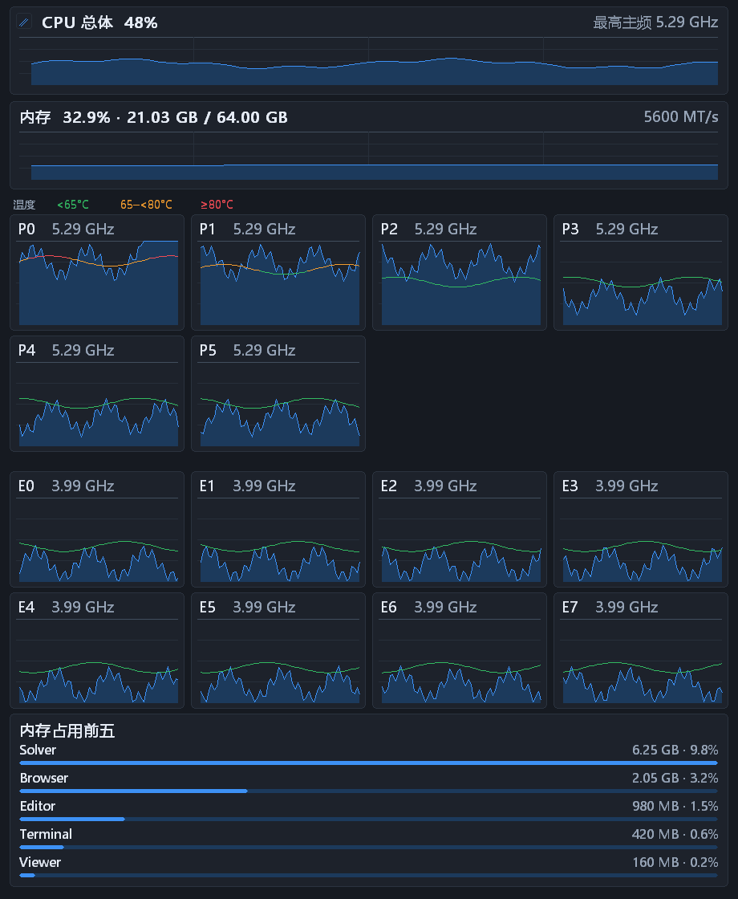
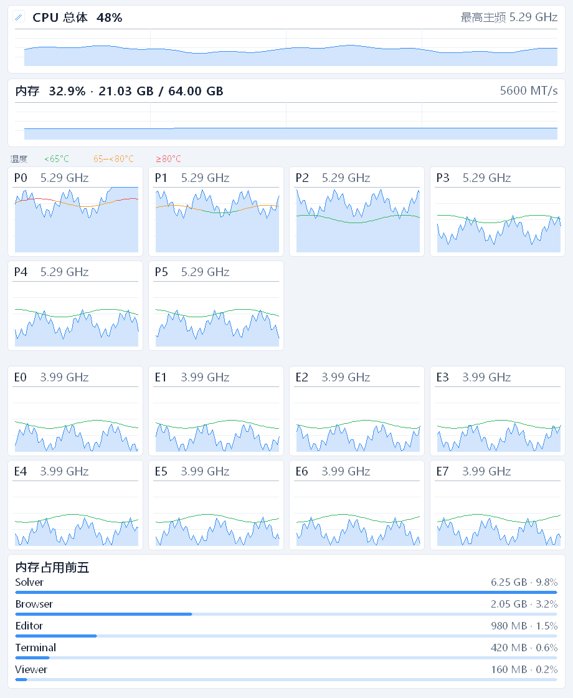

<div align="center">

# CoreTrace

**把每个核心的忙碌、温度和频率，留在桌面一角。**

低 CPU 占用 · 低内存占用 · 原生 Windows · 便携运行

[](https://github.com/TigerBruce/CoreTrace/actions/workflows/windows.yml)
[](LICENSE)


[快速开始](#快速开始) · [使用指南](guide/USAGE.md) · [CPU 统计口径](guide/METRICS.md) · [参与贡献](CONTRIBUTING.md) · [English](README.en.md)

</div>

CoreTrace 把 CPU 历史曲线、每核温度、频率、系统内存和内存占用前五放进一个可调整大小的桌面窗口。固定后隐藏编辑工具，普通应用可以覆盖它；需要调整时，点击左上角的小铅笔即可。

适合想在编译、仿真或日常工作时看一眼负载变化，又不想一直打开完整监控面板的人。

## 核心亮点：监控电脑，也少占用电脑

**低 CPU 占用和低内存（DDR）占用，是 CoreTrace 从架构到绘图都围绕的设计目标。** 为了适合桌面常驻，程序采用原生 C++ / Win32 / GDI，并专门优化了采样节奏、历史存储和绘图资源复用，尽量把计算时间与内存留给仿真、编译等实际任务。

| 优化方向 | 已实现的设计 | 对常驻使用的意义 |
| --- | --- | --- |
| **低 CPU 占用** | 每轮采样后等待约 1 秒，不忙轮询，也不为追赶固定时钟密集补采；采样线程使用低于普通线程的优先级 | 减少频繁唤醒，在电脑繁忙时降低监控工作的调度优先级 |
| **减少绘图开销** | 数据更新和界面事件触发重绘，无持续高帧率动画；暂停、隐藏或最小化时不由采样更新触发重绘 | 避免为不可见或已冻结的图表反复绘制；后台采样仍继续 |
| **低内存占用** | 原生程序无需浏览器引擎或 .NET 运行时；历史固定为 70 帧环形缓冲区 | 减少运行时负担，历史数据不会随运行时长无限累积 |
| **复用已有资源** | 复用进程查询缓冲区和绘图表面；绘图位图仅在尺寸变化时重建；不透明模式释放额外的透明合成表面 | 减少重复分配与不必要的绘图内存 |
| **减少后台活动** | 正常运行不联网，不持续写遥测日志 | 避免周期性上传与日志写盘 |

这里的“低内存占用”指 CoreTrace 自身占用的系统 RAM，并非测量 DDR 带宽。实际开销会随窗口像素尺寸、透明度、核心数和系统进程数变化；这些优化是已实现的设计，不是所有电脑上固定 CPU 百分比或固定内存大小的承诺。

## 界面预览

| 深色 | 浅色 |
| :---: | :---: |
|  |  |

预览由当前程序的真实绘图代码生成，使用固定演示数据，展示 6P + 8E 布局；不是性能实测。窗口大小、字号、透明度与历史范围均可调整。

## 能看到什么

| 内容 | 显示方式 |
| --- | --- |
| CPU 总体 | 历史面积图，右侧显示当前读取到的最高核心频率 |
| 每个物理核心 | P/E 分组；蓝色负载面积叠加温度线，标题显示核心频率 |
| 温度 | 低于 65°C 为绿，65–<80°C 为橙，达到 80°C 为红 |
| 内存总量 | 已用百分比、已用/总容量、历史曲线与配置速率 MT/s |
| 内存占用前五 | 按进程名称合并的私有工作集，使用统一比例的横向柱形图 |
| 最近的变化 | 20 秒、40 秒或 1 分钟历史；编辑模式悬停查看当时的 CPU 前五 |

## 为桌面常驻而设计

- **可拖动布局**：拖动窗口边缘改变长宽；CPU 总体和内存同步调整高度；内存前五单独调整高度；核心卡片自动换列。
- **固定与编辑分开**：固定时收起菜单与标题栏，保留一个小编辑按钮；底部菜单和系统托盘均可退出。
- **独立透明度**：分别调整外框背景和卡片底色，文字、曲线保持清晰。提供深浅主题、全局字号和字体选择。
- **有限历史、按需重绘**：保留 70 帧内存历史，采样完成后等待约 1 秒；没有高帧率动画。不为日常监控持续写日志。
- **原生便携程序**：不依赖 Electron、WebView 或 .NET；正常运行不联网。设置保存在 EXE 同目录的 `settings.ini`。

## 快速开始

### 直接使用构建产物

1. 打开 [Windows build](https://github.com/TigerBruce/CoreTrace/actions/workflows/windows.yml)，选择 `main` 分支最近一次成功的构建。
2. 在 **Artifacts** 下载 `CoreTrace-windows-x64`（GitHub 可能要求先登录）。解压下载文件，再解压其中的便携 ZIP。
3. 把整个文件夹放在有写入权限的位置，运行 `CoreTrace.exe`。点击 CPU 总体卡片左上角的小铅笔，调整后点击「固定」。

构建产物是开发版本，受 GitHub 保留期限限制。当前不承诺稳定版发布周期；也可以直接从源码构建。

### 从源码构建

```powershell
git clone https://github.com/TigerBruce/CoreTrace.git
cd CoreTrace
powershell -NoProfile -File ./setup-tools.ps1
./build.cmd
./native-portable/CoreTrace.exe --adjust
```

首次准备编译器需要联网，脚本会校验下载文件的 SHA-256；之后可离线构建。完整步骤与打包方式见 [BUILDING.md](BUILDING.md)。

### 温度与硬件频率

CPU 占用和内存统计无需额外驱动。每核温度、硬件频率需要另行安装官方 [PawnIO](https://github.com/namazso/PawnIO)，并保留 EXE 同目录的 `IntelMSR.bin`。CoreTrace 不会自动安装驱动。

| 范围 | 当前状态 |
| --- | --- |
| 运行平台 | 面向 Windows 10/11 x64；不提供 ARM64 或 32 位构建 |
| CPU 与内存统计 | 使用 Windows 系统接口；跨硬件兼容性仍需更多实测 |
| 温度与硬件频率 | 已实现部分 Intel Alder/Raptor Lake 型号，i5-14600K 已验证 |
| AMD 与其他 CPU 传感器 | 当前未实现；不代表基本负载与内存统计一定不可用 |
| P/E 分组 | 依据 Windows 上报的效率类别；无法区分时使用 C 编号 |

## 为什么有两种 CPU 百分比

默认 **任务管理器（Utility）** 使用 Windows 的 `% Processor Utility`，用于对齐开发机任务管理器的统计口径。可切换为 **忙碌时间（Time）**，查看线程在采样期间有多少时间处于非空闲状态。

每核小图取该物理核心内**最忙逻辑线程**的值，不将两个线程相加。总体 Utility 直接读取 Windows `_Total`，也不是把各核心图表取平均。两种模式均显示为 0–100%，顶部横线代表 100%。

独立采样时间和 Windows 版本可能造成显示差异；100% 不等于所有物理执行资源耗尽，78% 也不意味着某个仿真还能加速 22%。详见 [统计口径与常见疑问](guide/METRICS.md)。

## 文档与贡献

- [使用指南](guide/USAGE.md)：移动、缩放、固定、透明度、字体和常见问题。
- [构建指南](BUILDING.md)：编译器、源码入口、便携打包与自动构建。
- [统计说明](guide/METRICS.md)：Utility / Time、内存和频率的含义。
- [贡献指南](CONTRIBUTING.md)：报告问题、兼容性反馈与提交修改。
- [更新记录](CHANGELOG.md)：当前公开版本的功能范围。

欢迎通过 [Issues](https://github.com/TigerBruce/CoreTrace/issues) 反馈 CPU 型号兼容性、显示问题和功能建议。提交 CPU 数值对比时，请同时注明统计模式、Windows 版本和比较工具。

## 许可证与致谢

CoreTrace 原创代码与文档采用 [MIT License](LICENSE)，允许使用、修改和再分发。第三方模块、工具链及现有图标素材不因本项目的 MIT 声明改变各自权利，范围说明见 [NOTICE.md](NOTICE.md)。

感谢 [PawnIO](https://github.com/namazso/PawnIO)、[PawnIO.Modules](https://github.com/namazso/PawnIO.Modules)、[LibreHardwareMonitor](https://github.com/LibreHardwareMonitor/LibreHardwareMonitor) 和 [llvm-mingw](https://github.com/mstorsjo/llvm-mingw)。
